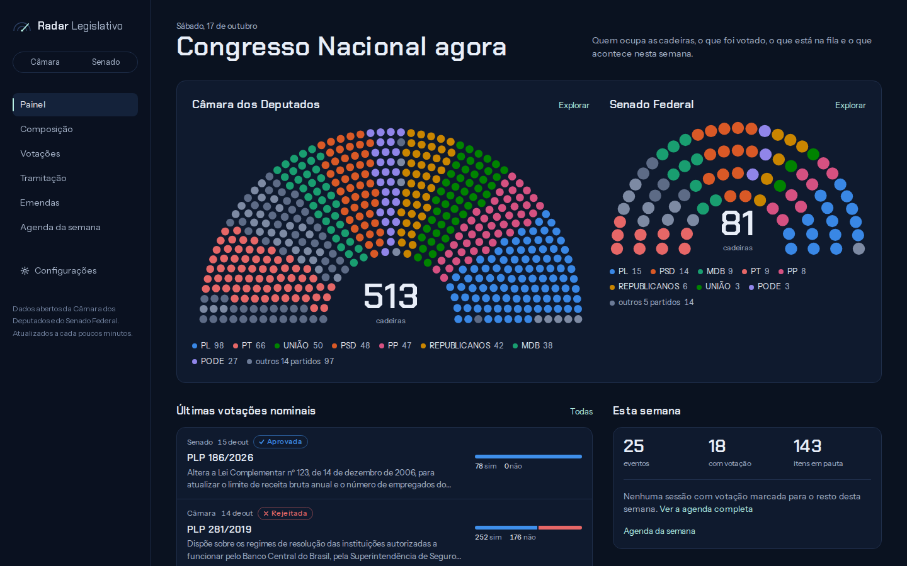
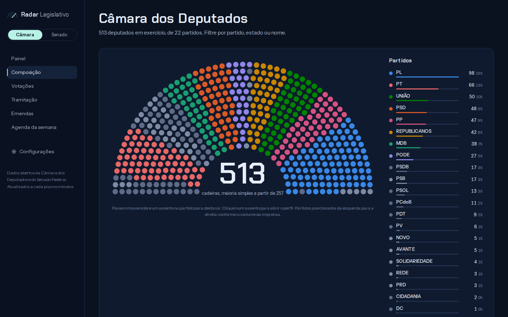
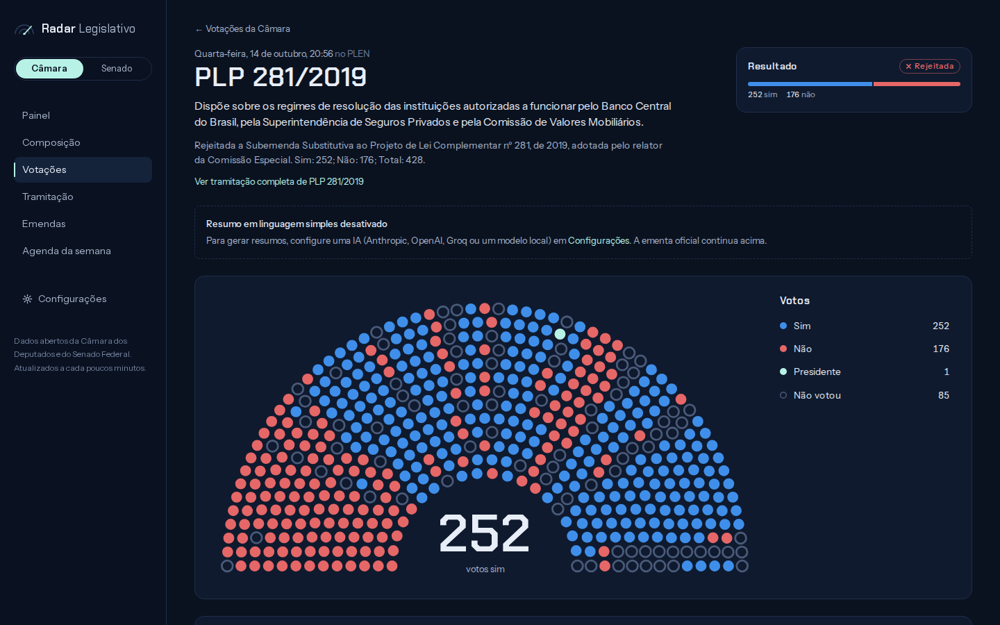
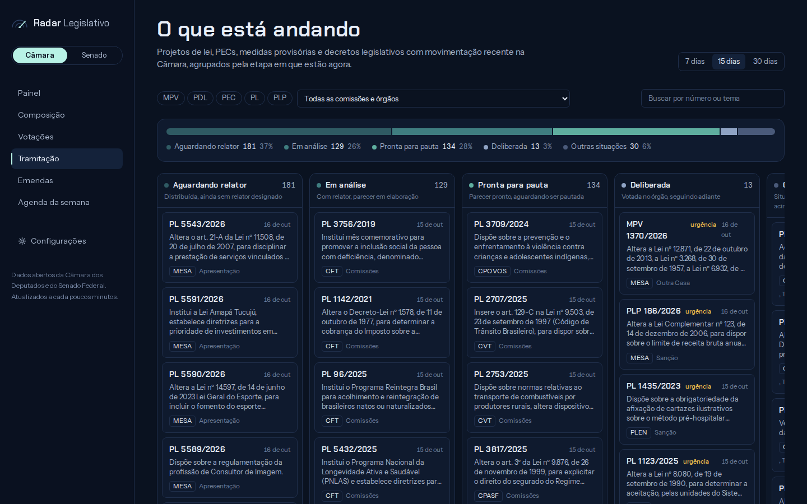
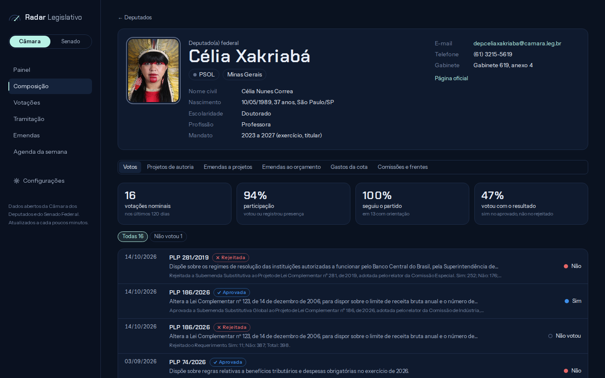
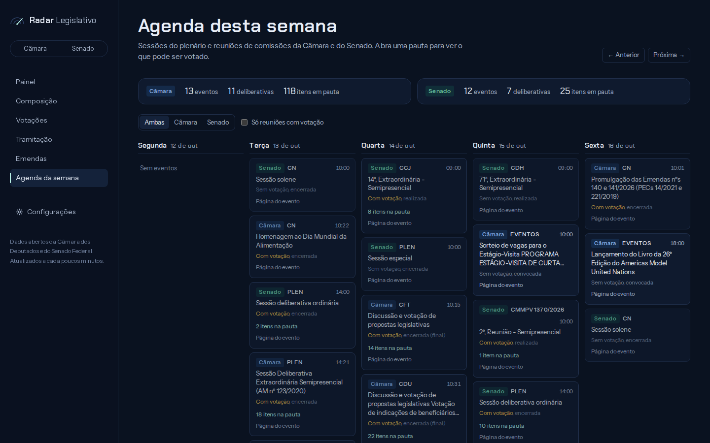
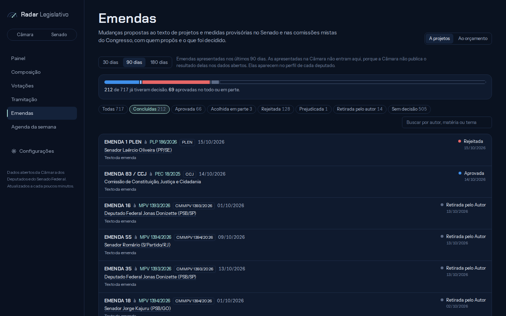

# Radar Legislativo

Painel local para acompanhar o Congresso Nacional (Câmara dos Deputados e Senado Federal) usando os dados abertos oficiais.



- **Composição**: hemiciclo por partido, bancadas por estado e lista de parlamentares, com filtros cruzados.
- **Votações**: realizadas (7, 30 ou 90 dias) e previstas (pautas das próximas sessões). Cada votação mostra placar, hemiciclo colorido pelo voto, orientação e fidelidade de cada bancada e o voto nominal de cada parlamentar.
- **Tramitação**: proposições com movimento recente agrupadas pela etapa em que estão (aguardando relator, em análise, pronta para pauta, em pauta), filtráveis por tipo, comissão e tema. Cada proposição tem ficha com fase, relator, linha do tempo e votações.
- **Agenda da semana**: sessões de plenário e reuniões de comissões das duas Casas, com as pautas.
- **Perfil de cada parlamentar**: dados pessoais e de contato, votos nominais com participação e fidelidade partidária, projetos de autoria, emendas a projetos, emendas ao orçamento, gastos da cota parlamentar dos últimos 12 meses, comissões, frentes e filiações. Clique em qualquer assento ou nome para abrir.
- **Emendas**: a projetos (Senado e comissões mistas do Congresso, com autor e decisão) e ao orçamento (Portal da Transparência, com autor, destino e quanto foi pago).
- **Resumo em linguagem simples** (opcional): gerado por IA (Claude, GPT, Groq ou um modelo rodando no seu computador) a partir da ementa e da tramitação, quando você clica em **Gerar resumo**, e guardado em cache.

## Telas

| | |
|---|---|
|  |  |
| **Composição** | **Votação** |
|  |  |
| **Tramitação** | **Perfil de parlamentar** |
|  |  |
| **Agenda da semana** | **Emendas** |

## Rodando

Requer Node 20 ou superior e o [uv](https://docs.astral.sh/uv/getting-started/installation/), que cuida do Python do serviço de IA (instala a versão certa e as dependências na primeira execução).

```bash
npm install
npm run dev                  # http://localhost:3000
```

O `npm run dev` sobe dois processos com os logs identificados: o site (`[web]`, Next.js) e o serviço de IA (`[ia]`, Python, na porta 8787, só para este computador). Sem o uv o site funciona normalmente, só sem os resumos.

Para uso diário, `npm run build && npm start` é mais rápido.

Por padrão o Radar só aceita conexões do próprio computador (`127.0.0.1`). Para abrir pelo celular ou outro aparelho da mesma rede, use `npm run dev:rede` ou `npm run start:rede` e acesse pelo IP da máquina. Faça isso só em redes de confiança: quem estiver na rede consegue gerar resumos cobrados na sua conta de IA.

### Com Docker (sem Node nem Python)

```bash
docker compose up -d         # http://localhost:3000
```

Sobe o Radar e um [Ollama](https://ollama.com) já configurado para os resumos, sem nenhuma chave. Na primeira vez o modelo padrão (`llama3.1:8b`, cerca de 5 GB) é baixado; acompanhe com `docker compose logs -f ollama-modelo`. Para outro modelo: `OLLAMA_MODEL=qwen2.5:3b docker compose up -d`. O modelo que ordena a pauta para você se troca do mesmo jeito: `EMBEDDING_MODEL=qwen3-embedding:4b docker compose up -d` baixa o novo modelo e passa a usá-lo.

- Sem GPU o Ollama roda no processador e cada resumo pode levar um minuto ou mais. Com placa NVIDIA, descomente o bloco `deploy` no `docker-compose.yml` (requer o NVIDIA Container Toolkit). No Mac, o Docker não usa a GPU; ali vale mais instalar o Ollama direto ou usar uma chave de API.
- Para usar Anthropic, OpenAI ou Groq, cole a chave em Configurações. Com uma chave salva, escolha qual IA usar no seletor que aparece.
- Chaves e cache ficam em volumes do Docker e sobrevivem a `docker compose down`. Para apagar tudo, inclusive o modelo baixado: `docker compose down -v`.
- Para atualizar depois de um `git pull`: `docker compose up -d --build`.

### Chaves opcionais

Dois recursos dependem de serviços externos, e tudo se configura pela própria ferramenta, em **Configurações** no menu. A tela explica como conseguir cada chave, testa antes de salvar e guarda em `.config/chaves.json` (fora do git, legível só pelo seu usuário). A edição só é permitida no próprio computador (`localhost`), não por outros aparelhos da rede.

- **Resumos em linguagem simples**: escolha entre Anthropic (Claude), OpenAI, Groq (tem plano gratuito) ou qualquer servidor compatível com a API da OpenAI. Com o [Ollama](https://ollama.com) ou o LM Studio dá para rodar um modelo no seu computador, sem custo e sem enviar nada para fora. Com mais de uma configurada, a tela tem um seletor de qual usar. O resumo só é gerado quando você clica em **Gerar resumo** na página da proposição ou da votação, para não gastar com o que você não vai ler. Em **Personalizar os resumos** dá para contar quem você é (por exemplo, "sou estudante de medicina"); com isso, ao lado do botão aparece **Usar meu "Sobre você"**, que acrescenta ao resumo um item "Para você". Dá para ver as duas versões, com e sem, e cada uma fica guardada. Na parte avançada, dá para reescrever as instruções da IA. O formato do resumo e as regras de não opinar e usar só os dados oficiais continuam fixos.
- **Pauta para você**: ordena os itens previstos para votação pelo que mais tem a ver com o seu "Sobre você" ou com um tema que você digitar. Roda neste computador, com o Ollama, e só quando você pede; veja [Pauta para você](#pauta-para-você).
- **Emendas ao orçamento**: chave gratuita do Portal da Transparência.

Quem preferir pode usar variáveis de ambiente em `.env.local` (veja `.env.example`, que também mostra como trocar o modelo de cada provedor); uma configuração salva pela tela tem prioridade.

## Pauta para você

Na aba **Previstas** de Votações (Câmara ou Senado), o painel **Para você** mostra os 5 itens da pauta dos próximos 14 dias mais ligados a:

- **seu perfil**: o botão **Ordenar pelo meu perfil** usa o que você escreveu em "Sobre você", em Configurações → Personalizar os resumos. Só aparece com o "Sobre você" preenchido;
- **um tema**: digite qualquer texto no campo ao lado e clique em **Buscar**, por exemplo "saúde" ou "planos de saúde e SUS". Serve para ver a pauta por outro ângulo sem mudar o perfil (seu perfil é de tecnologia, mas hoje você quer ver o que há de saúde). Funciona mesmo sem "Sobre você".

A lista completa continua logo abaixo. Nada roda sem o clique: abrir a página não ocupa o processador, e quem não quiser o recurso simplesmente não usa.

### Como funciona

O serviço de IA (`ia/radar_ia/agenda.py`) transforma o seu perfil (ou o tema digitado) e a ementa de cada item em vetores com um modelo de embeddings do Ollama e ordena os itens pela semelhança entre eles. Não é um modelo que escreve texto, e nada sai do seu computador.

- O vetor de cada proposição não depende de quem lê, então é calculado uma vez e guardado em `.cache/pauta/` (90 dias, refeito se a ementa mudar).
- Mudar o "Sobre você" ou buscar outro tema só recalcula esse texto: a nova ordem sai em menos de um segundo.
- Itens sem ementa (alguns requerimentos) ficam de fora, porque só o título diz pouco.
- É uma aproximação por semelhança de texto: pode colocar no topo algo que só parece relacionado. Em pautas sem nada ligado ao seu perfil, os 5 primeiros são só os menos distantes.

### Requisitos

- Ollama rodando e o modelo baixado. O padrão é o [`qwen3-embedding:0.6b`](https://ollama.com/library/qwen3-embedding) (cerca de 640 MB).
- Cerca de 1,2 GB de memória livre enquanto ordena.
- Tempo no processador, sem placa de vídeo: uns 0,25 s por item novo. Na primeira vez, uma pauta cheia (cerca de 150 itens na Câmara) leva perto de um minuto; depois é quase instantâneo.

### Como ligar

**Com Docker Compose** já vem pronto: o `docker compose up -d` baixa o modelo junto com o dos resumos. Acompanhe com `docker compose logs -f ollama-modelo`.

**Com `npm run dev`**, instale o [Ollama](https://ollama.com) e baixe o modelo:

```bash
ollama pull qwen3-embedding:0.6b
```

O Radar procura o Ollama em `http://127.0.0.1:11434`. Em outro endereço, defina `EMBEDDING_URL` no `.env.local`.

Para ordenar pelo perfil, preencha "Sobre você" em **Configurações** (por exemplo, "sou estudante de medicina e me interesso por saúde pública"); a busca por tema não precisa disso. A linha "Pauta para você" no mesmo painel diz se está tudo certo ou o que falta.

### Trocar o modelo

O modelo é a variável `EMBEDDING_MODEL`.

- **Docker Compose**: `EMBEDDING_MODEL=qwen3-embedding:4b docker compose up -d` baixa o novo modelo e passa a usá-lo. Para fixar, coloque `EMBEDDING_MODEL=qwen3-embedding:4b` num arquivo `.env` ao lado do `docker-compose.yml`. Sem a variável, volta ao padrão.
- **`npm run dev`**: `ollama pull qwen3-embedding:4b` e `EMBEDDING_MODEL=qwen3-embedding:4b` no `.env.local`.

O `qwen3-embedding:4b` acerta um pouco mais, mas no processador é cerca de 6 vezes mais lento e usa uns 3,4 GB de memória; vale a pena com placa de vídeo. O texto enviado ao modelo segue o formato da família Qwen3 Embedding, então modelos de outras famílias podem ordenar pior. Ao trocar de modelo, a primeira ordenação calcula todos os itens de novo.

### Problemas comuns

| A tela diz | O que fazer |
|---|---|
| "O Ollama não está respondendo em …" | Inicie o Ollama, ou confira o `EMBEDDING_URL`. |
| "Falta baixar o modelo: rode ollama pull …" | Rode o comando indicado (no Docker: `docker compose exec ollama ollama pull …`). |
| "O serviço de IA não está rodando" | Inicie o Radar com `npm run dev`, que sobe o site e o serviço juntos. |
| Demora muito na primeira vez | É o cálculo de cada item novo; nas próximas vezes fica guardado. |

## Como funciona

- `ia/` é o serviço de IA, em Python (FastAPI). Ele escolhe o provedor, monta o prompt, chama a Anthropic, a OpenAI, a Groq ou o servidor compatível, valida o JSON e guarda cada resumo em `.cache/resumos/` por uma semana. O site só repassa a proposição para ele (`src/lib/ia.ts`) e mostra o resultado.
  - `ia/radar_ia/resumo.py`: prompt, schema e validação dos resumos.
  - `ia/radar_ia/agenda.py`: ordenação da pauta por semelhança com o "Sobre você" (embeddings).
  - `ia/radar_ia/cache.py`: cache em disco compartilhado pelos dois.
  - `ia/radar_ia/provedores.py`: chamadas a cada provedor e teste de chaves.
  - `ia/radar_ia/config.py`: lê `.config/chaves.json` e `.env.local`, com a mesma prioridade do site.
  - Para depurar, rode `npm run dev:web` (só o site) e suba o serviço pelo seu editor ou com `npm run ia:dev`; os testes rodam com `npm run ia:test`. A documentação interativa da API fica em http://127.0.0.1:8787/docs.

- `src/lib/camara.ts` e `src/lib/senado.ts` falam com as APIs oficiais e convertem tudo para o modelo comum em `src/lib/types.ts`.
  - Câmara: https://dadosabertos.camara.leg.br/api/v2
  - Senado: https://legis.senado.leg.br/dadosabertos
- `src/lib/cache.ts` guarda as respostas em memória e em `.cache/` (disco), com validade por tipo de dado: votações passadas por dias, agenda e votações recentes por minutos. Se a fonte oficial cair, o último dado bom é reaproveitado. Apague `.cache/` para forçar a recarga.
- `src/lib/fase.ts` traduz a "situação" em texto livre de cada Casa para uma fase do processo e uma etapa dentro da comissão. As regras são expressões regulares; ajuste ali se alguma situação nova cair em "Outras situações".
- `src/lib/partidos.ts` define a ordem dos partidos no hemiciclo e as cores. As oito maiores bancadas têm cores próprias (paleta validada para daltonismo); as demais usam tons neutros e são identificadas pela legenda.

## Limitações conhecidas

- A Câmara não publica nos dados abertos o resultado das emendas a projetos nem a qual projeto cada uma se refere. No perfil do deputado elas aparecem com link para o texto; a página Emendas mostra só as do Senado e das comissões mistas, que têm decisão registrada.
- O primeiro perfil de deputado aberto leva até um minuto na aba Votos: o sistema cruza todas as votações nominais dos últimos 120 dias. Depois disso todos os perfis usam o mesmo índice em cache.
- Emendas ao orçamento: o Portal da Transparência não filtra por situação, então "concluída" (totalmente paga) é calculado a partir dos valores. A busca por autor usa o nome parlamentar e, se não achar, o nome civil. A API permite 90 consultas por minuto, por isso as buscas grandes são limitadas às primeiras páginas.

- A primeira abertura da tramitação da Câmara leva de 15 a 30 segundos: a API não informa a situação na listagem, então cada proposição é consultada uma vez e depois fica em cache.
- No Senado, a listagem de votações traz só as nominais; votações simbólicas aparecem na tramitação de cada matéria.
- O Senado raramente publica orientação de bancada nos dados abertos, então a fidelidade partidária costuma aparecer só na Câmara.
- Em semanas de recesso ou de eleição a agenda fica vazia; use as setas para navegar entre semanas.

## Segurança

- As chaves ficam em `.config/chaves.json` (modo 600) ou `.env.local`, ambos fora do git. Nunca faça commit delas.
- O Radar foi feito para rodar na sua máquina, não como site público: não há login, e qualquer pessoa que alcance o servidor pode gerar resumos com a sua chave de IA.
- A rota de resumo recusa pedidos vindos de outros sites (CSRF e DNS rebinding), e as chaves só podem ser alteradas acessando por `localhost`.

Encontrou uma falha? Abra uma issue sem detalhes sensíveis ou use o [reporte privado de vulnerabilidades](https://docs.github.com/pt/code-security/security-advisories/guidance-on-reporting-and-writing-information-about-vulnerabilities/privately-reporting-a-security-vulnerability) do GitHub.

## Licença

[MIT](LICENSE). Os dados exibidos vêm das APIs de dados abertos da Câmara, do Senado e do Portal da Transparência, sujeitos aos termos de uso de cada fonte.
